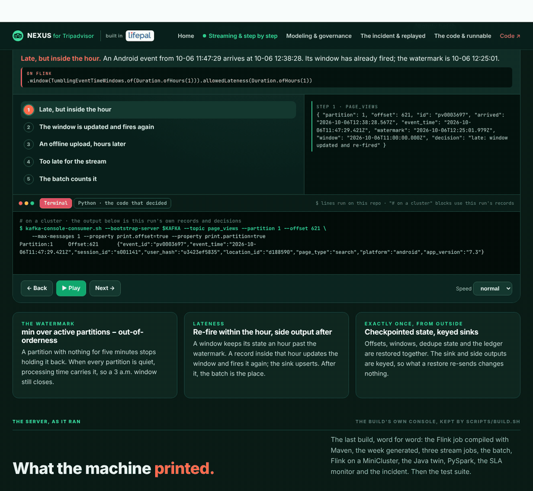

# NEXUS for Tripadvisor

An independent Senior Data Engineer (Data Platform) portfolio by R. Firman Insan Muhammad (Vim), for Tripadvisor.

**Live site:** https://rfim.github.io/nexus-tripadvisor/ · **Streaming & step by step:** https://rfim.github.io/nexus-tripadvisor/stream.html · **The incident & replayed:** https://rfim.github.io/nexus-tripadvisor/oncall.html · **The code & runnable:** https://rfim.github.io/nexus-tripadvisor/run.html · **The fireside story:** https://rfim.github.io/nexus-tripadvisor/story.html

**Fireside deck:** [assets/Nexus_Tripadvisor_VIM.pdf](assets/Nexus_Tripadvisor_VIM.pdf) · **One page:** [assets/VIM_Tripadvisor_one_page.pdf](assets/VIM_Tripadvisor_one_page.pdf)

The PDFs are built from `docs/pdf-src/` with the run's data: `python docs/pdf-src/build.py && node scripts/pdfs.js`.

**GIFs:** [assets/gif/1_NEXUS_Tripadvisor_stream_step_by_step.gif](assets/gif/1_NEXUS_Tripadvisor_stream_step_by_step.gif) (late records, a poison pill, an erasure) · [assets/gif/2_NEXUS_Tripadvisor_incident_replayed.gif](assets/gif/2_NEXUS_Tripadvisor_incident_replayed.gif) (the SLA breach, minute by minute)



This repository applies the methods I used at Lifepal to data shaped like a travel site's: page views, partner clicks and reviews on Kafka, an event-time stream job with Flink's semantics (and a Java twin), a nightly Spark batch that checks the stream, one contract rendered to Snowflake and BigQuery, and SLAs measured the way consumers feel them, with an incident and its postmortem. The numbers on the site come from a real run of the code here, on synthetic data.

## The path

```
Kafka (simulated) → stream job → Snowflake / BigQuery      nightly batch (Python + PySpark) → reconcile → hold → Gold
  generate.py        stream.py     warehouse.py             batch.py · spark_batch.py           batch.py      sla.py
```

- **Capture.** `src/nexus/generate.py` runs a travel site for a week and writes what the brokers keep: one JSON-lines log per partition, offsets in arrival order, the producer's value as a string.
- **Stream.** `stream.py` is the job: upcast every schema version, de-duplicate on id (24 hours of checkpointed state), window by event time, fire when the watermark (min over active partitions, less out-of-orderness) passes, re-fire within an hour of allowed lateness, side output after it, dead-letter what can't be read. Offsets, windows, dedupe state and the ledger are checkpointed together; sinks are keyed, so a restore changes nothing downstream.
- **Check.** `batch.py` recomputes every window from the whole topic. `reconcile()` proves that every difference from the stream is the stream's side output. `spark_batch.py` does the same in PySpark and must agree window for window.
- **Hold.** An hour more than 2σ above the same hour on earlier days, and at least double it, is held from Gold until investigated (a scraper, here).
- **Publish.** `warehouse.py` renders the DDL, MERGE, masking/policy tags and erasure for Snowflake and BigQuery from `contracts/sources.yml` into `warehouse/`, then loads Gold into SQLite with the same upsert semantics and runs the checks in `contracts/quality.yml`.
- **Watch.** `sla.py` measures freshness from the completeness the job publishes (not the newest non-empty window), samples every five minutes, computes error budgets, and writes the incident record and postmortem (`assets/data/incident.md`).

## The six planted problems

| Problem | Where | What catches it |
|---|---|---|
| SDK retries re-send the same event_id at a new offset | page_views, 6 Oct 11:30–13:00 | dedupe on id, checkpointed |
| An offline upload, 2–8 hours late | page_views, 7 Oct 18:00 | side output past lateness; the batch counts them |
| Schema v2: `price {amount, currency}` replaces `cpc_gbp` | partner_clicks, 7 Oct 09:00 | one reader upcasts both; unknown currency → dead letter |
| A poison pill: truncated JSON | partner_clicks p3, 9 Oct 14:05 | crash loop until the DLQ fix; SLA breach; postmortem |
| A scraper: 1,500 views in the quietest hour | page_views, 10 Oct 03:00 | volume hold, investigation, bot filter, release |
| Erasure, then a stale version with a new event id | reviews, 10 Oct 11:00 | version rule: tombstones can't be overwritten |

Plus a lost TaskManager on 8 October at 09:17: restored from the checkpoint, sink identical to a run without the crash.

## Apache Flink and Java

- `flink/job/`: the stream jobs on **Apache Flink 1.20** (DataStream API, Java 17, Maven). `NexusJobs` is the topology: `Parse` (both schema versions, a dead-letter output), `Dedupe` (keyed `ValueState` with a 24-hour TTL), `PartitionWatermarks` (min over active partitions less out-of-orderness, idle partitions left out), tumbling event-time windows with `allowedLateness` and `sideOutputLateData`. `NexusLocal` replays the week on a MiniCluster; `NexusKafka` is the production entry point (`KafkaSource` with `withIdleness`, exactly-once checkpoints, `failureRateRestart`, transactional `KafkaSink`s for gold, DLQ and late). `tests/test_flink.py` requires the Python job's windows exactly on page_views, the batch's revenue exactly on partner_clicks, and the poison pill dead-lettered.
- `java/src/nexus/WindowJob.java`: the page_views job in plain JDK 17, no dependencies. `tests/test_java_twin.py` compiles it, runs it on the same week, and requires exactly the Python job's windows and ledger.
- `flink/*.sql`: the same jobs as Flink SQL (idle timeout, allowed lateness, late firing, upsert sinks). Written to be read.

## Run it

Python 3.11, Java 17 and Maven (for the Flink job):

```bash
pip install -r requirements.txt
PYTHONPATH=src python -m pytest -q     # topics, stream rules, Java twin, Spark batch, reconciliation, SLAs, warehouse SQL, site
./scripts/build.sh                     # the whole run; rewrites assets/data/site.json and warehouse/ (about 25 seconds)
python -m http.server 8000             # then open http://localhost:8000/
```

On the site, `run.html` opens every file in an editor and runs the Python in your browser with Pyodide (vendored in `assets/vendor/`, with small stand-ins in `assets/pyshims/`), including the whole week and the browser-safe tests.

## What's real

- **Real:** the Lifepal outcomes (from my CV and production work) and all the code here, which runs end to end in CI.
- **Synthetic:** every page view, click, review, partner and location. The Tripadvisor side comes from the job description and public information; no Tripadvisor systems or data were used.
- **Depth:** Kafka, Spark and Python are production experience; at Lifepal the streaming was Kafka + Debezium with Spark, not Flink. The Flink job here is real Flink 1.20, run on a MiniCluster in CI, not on a production cluster. Snowflake is production experience from Deloitte. BigQuery I haven't run in production: the SQL here is mapped from Snowflake and Databricks (partitioning and clustering for bytes scanned, MERGE, policy tags), and it's where I'd learn first. Java is the part of the stack I'd be ramping up on.

This is an independent application. It is not affiliated with or endorsed by Tripadvisor.
